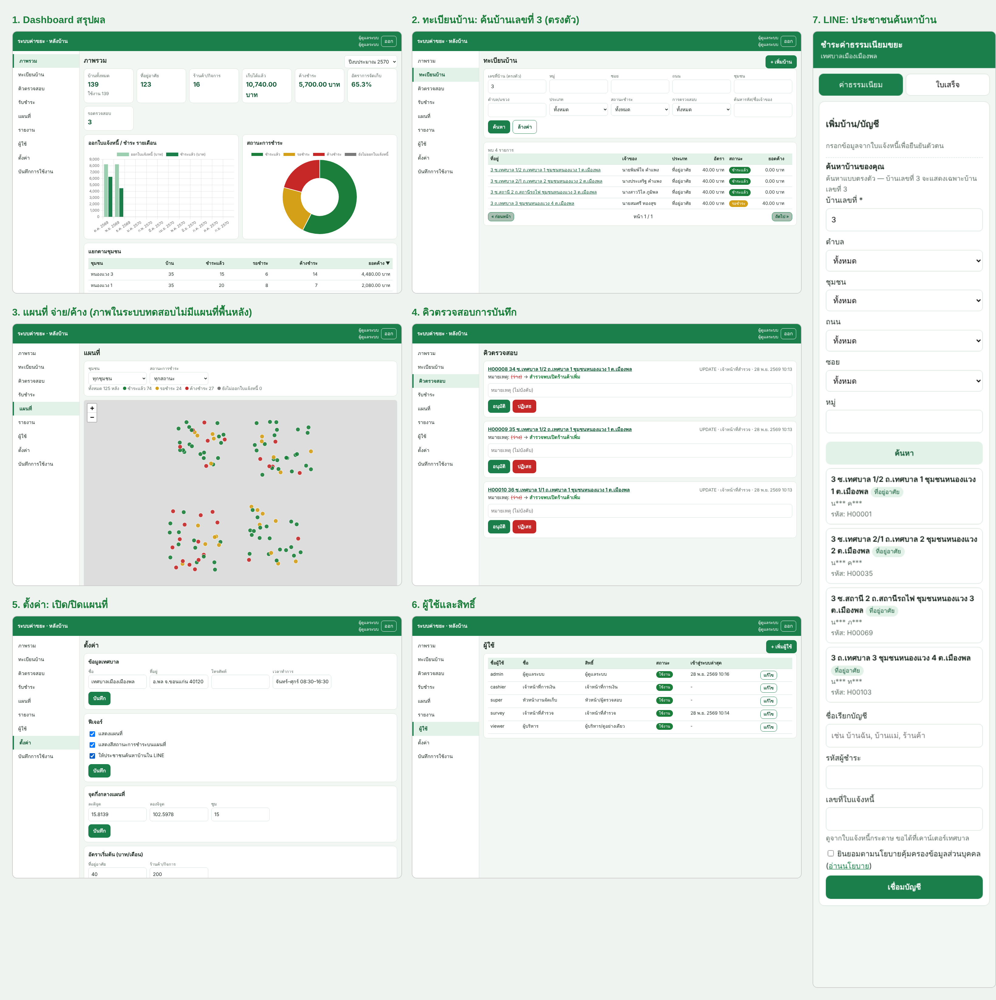
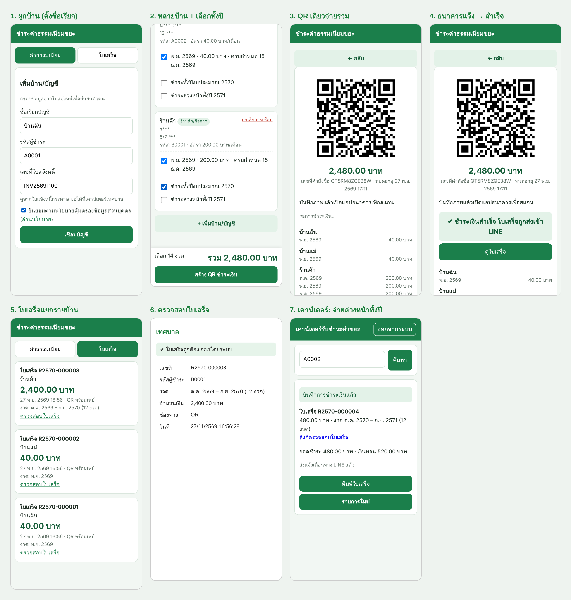

# ระบบค่าธรรมเนียมขยะเทศบาล (LINE OA + หลังบ้าน)

อ้างอิงพื้นที่: **เทศบาลเมืองเมืองพล อ.พล จ.ขอนแก่น** (แก้ข้อมูลเทศบาลได้ในหน้าตั้งค่า)

- **ประชาชน (LINE)**: ค้นหาบ้านตัวเอง (บ้านเลขที่ตรงตัว + ตำบล/ชุมชน/ถนน/ซอย) → ผูกหลายบ้าน → จ่ายรายเดือน/ทั้งปีด้วย Thai QR เดียว → ใบเสร็จดิจิทัลเข้า LINE
- **หลังบ้าน**: Dashboard, ทะเบียนบ้าน (สำรวจ/เพิ่ม/แก้ไข/ปักหมุด GPS), คิวตรวจสอบข้อมูล, รับชำระเงินสด, แผนที่สถานะจ่าย/ไม่จ่าย (เปิด/ปิดได้), รายงาน CSV, ผู้ใช้และสิทธิ์ 5 ระดับ, ตั้งค่า, บันทึกการใช้งาน





เอกสาร: [ออกแบบระบบ](docs/DESIGN.md) · [API + ตารางสิทธิ์](docs/API.md)

## ติดตั้งในเครื่อง (โหมดสาธิต) — Windows / macOS / Linux
ไม่ต้องติดตั้งฐานข้อมูล (ใช้ PostgreSQL ฝังในโปรแกรม) ข้อมูลเก็บในโฟลเดอร์ `server/demo-data` ไม่หายเมื่อปิด

1. ติดตั้ง [Node.js 22 LTS](https://nodejs.org) (22.18 ขึ้นไป) และ [Git](https://git-scm.com)
2. เปิด Terminal / PowerShell
```bash
git clone -b claude/vigilant-rubin-46m06v https://github.com/Unreal-No/Trash.git
cd Trash/server
npm install
npm run demo
```
3. เปิดเบราว์เซอร์
   - หลังบ้าน: http://localhost:3000/admin/
   - ประชาชน (จำลอง LINE): http://localhost:3000/liff/ — ค้นหาบ้านเลขที่ `3` หรือผูกด้วย `A0001` / `INV256911001`

| ผู้ใช้ | รหัสผ่าน | สิทธิ์ |
|---|---|---|
| admin | admin1234 | ผู้ดูแลระบบ |
| super | super1234 | หัวหน้า/ผู้ตรวจสอบ |
| cashier | cash1234 | เจ้าหน้าที่การเงิน |
| survey | survey1234 | เจ้าหน้าที่สำรวจ |
| viewer | view1234 | ผู้บริหาร (ดูอย่างเดียว) |

ข้อมูลสาธิตเป็นข้อมูลสมมติ (139 หลัง ชุมชนหนองแวง 1–4) · เริ่มใหม่: ปิดโปรแกรม แล้วลบโฟลเดอร์ `server/demo-data`

## ทดสอบ
```bash
cd server && npm test
```

## ใช้งานจริง
1. ขอ Biller ID + spec callback จากธนาคาร → ปรับ `server/src/bank/adapter.ts`
2. สร้าง LINE OA (Messaging API) + LINE Login + LIFF (endpoint `https://<domain>/liff/`) · webhook `https://<domain>/webhook/line`
3. `cp server/.env.example server/.env` แล้วกรอกค่า (สร้าง `DATA_KEY` ด้วย `openssl rand -hex 32` และสำรองไว้ — ถ้าหายจะถอดรหัสชื่อ/เบอร์โทรไม่ได้)
4. เลือกฐานข้อมูล
   - เครื่องเดียว: ไม่ต้องตั้ง `DATABASE_URL` → `cd server && npm start` (ข้อมูลอยู่ที่ `DATA_DIR`)
   - PostgreSQL: `DB_PASSWORD=... docker compose up -d`
5. เข้า `/admin/` ด้วย `ADMIN_USERNAME`/`ADMIN_PASSWORD` แล้วเพิ่มผู้ใช้ ตั้งค่าเทศบาล รายชื่อชุมชน อัตราค่าธรรมเนียม
